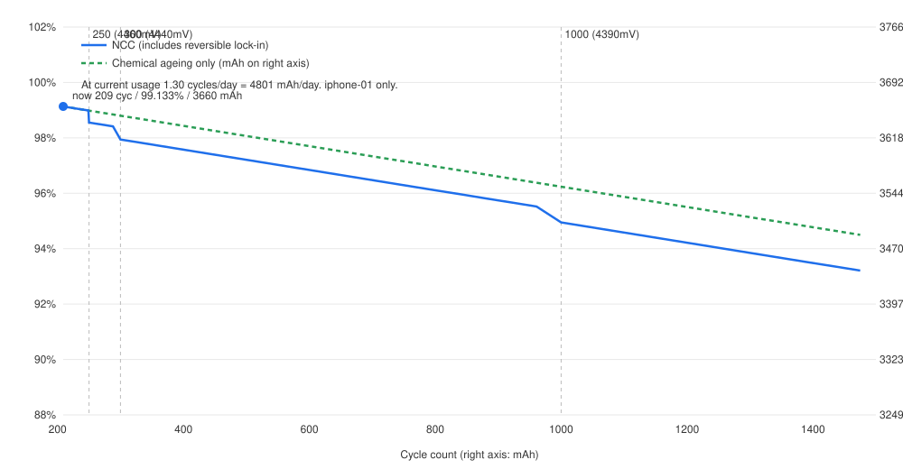

<div align="center">

# apple-device-metrics

**English** · [中文](README.zh.md) · [Website](https://savues.github.io/apple-device-metrics/)

[](https://github.com/Savues/apple-device-metrics/actions/workflows/verify.yml)
[](https://savues.github.io/apple-device-metrics/)
[](LICENSE)


</div>

Battery and charging measurements from my own iPhones, published de-identified.
The numbers come from iOS analytics files and the charging log, not from
marketing material; the scripts that turn those files into the tables below are
in the repository.

### At a glance (`iphone-01`, latest snapshot <!--v:base_date-->2026-11-17<!--/-->)

| Cycles | NCC | NCC ÷ 3692 | Apple displayed | Voltage target | Usage |
|:-:|:-:|:-:|:-:|:-:|:-:|
| **<!--v:base_cycle-->212<!--/-->** | **<!--v:base_ncc-->3660<!--/--> mAh** | **<!--v:base_health_two-->99.13<!--/-->%** | **<!--v:apple-->101<!--/-->%** | **<!--v:vac-->4480<!--/--> mV** | **<!--v:rate-->1.30<!--/--> cycles/day** |

Next node: 250 cycles → 4460 mV, point estimate ~<!--v:date_next-->2026-12-16<!--/-->, i.e.
<!--v:date_next_lo-->2026-12-11<!--/--> … <!--v:date_next_hi-->2026-12-25<!--/--> across the usage windows I could measure
(pre-registered in [`docs/predictions.json`](docs/predictions.json)). The 1000-cycle row is
<!--v:date_kilo-->2028-07-15<!--/--> by the same arithmetic and spreads just as widely,
<!--v:date_kilo_lo-->2028-04-15<!--/--> … <!--v:date_kilo_hi-->2029-01-20<!--/-->; treat the single date as a point estimate, not a
promise ([`docs/iphone17-forecast.md`](docs/iphone17-forecast.md)).

<p align="center"></p>

> Charge Limit on this phone is set to 80% as a fallback, but I unplug before
> 80% almost every session, so the calibration full charge iOS occasionally runs
> never got a chance during these <!--v:span_days-->76<!--/--> days. Findings that depend on cycle count
> (the voltage steps, the forecast) are unaffected. The gauge-derived capacity
> and the displayed SOC carry a bias I cannot quantify. Details in
> [`docs/shallow-charging-accuracy.md`](docs/shallow-charging-accuracy.md).

---

## Devices

| ID | Platform | Data | Coverage |
|----|----------|------|----------|
| [`iphone-01`](devices/iphone-01/) | **iPhone 17**, iOS 26.4.2, 3.887V / 3692mAh / 4.50V limit | <!--v:snap_n-->9<!--/--> analytics snapshots + 6-row health export, <!--v:sessions-->325<!--/--> charge sessions, 1 voltage reading | 2026-09-01 → <!--v:base_date-->2026-11-17<!--/--> (<!--v:span_days-->76<!--/-->-day charging diary) |
| [`reference-01`](devices/reference-01/) | iOS 17.6.1, 1420 cycles, 3.83V / 2815mAh / 4.45V | single analytics snapshot, reference only | 2026-11-15 |
| [`reference-02`](devices/reference-02/) | iOS 15.1, 3.83V / 3110mAh / 4.45V | nameplate + one gauge snapshot (2919 cycles, 67%); no `VacVoltageLimit` | 2026-11-15 |

The two reference phones were here anyway, so I used them to check the
voltage-node ladder, the two way of measuring health, and the nameplate energy
arithmetic. They never enter `iphone-01`'s statistics or its forecast. The one
place they show up as data is the cross-device anchors in
[`docs/lifetime-projection.md`](docs/lifetime-projection.md), where they are
labelled as reference points.

More devices can be added as sibling directories under `devices/`.

---

## Headline findings

1. There are two different "battery health" numbers. `nominal_health_pct`
   (<!--v:base_health_two-->99.13<!--/-->%) is `NominalChargeCapacity / 3692`, a ratio the export tool computes
   against the fixed nameplate. Apple's own `MaximumCapacityPercent` reads 101
   and did not move across the 200-cycle step. Every decay figure below is the
   NCC ratio, not what iOS displays. See
   [`ANALYTICS-EVIDENCE.md`](devices/iphone-01/ANALYTICS-EVIDENCE.md) §6.

2. Degradation is stepwise, not linear. Flat stretches of ~0.004%/day, which is
   real chemical ageing, with two one-off drops: ~−0.41pp at 126→152 cycles and
   ~−0.43pp at 194→208.

3. The 194→208 drop straddles cycle 200. That matches a widely reported
   (non-official) mechanism where iOS lowers the software charge-voltage target
   at cycle nodes, 0.02V per step at 200 / 250 / 300 and 0.05V at 1000. The
   4.50V nameplate is the cell ceiling; the software target sits below it. See
   [`docs/voltage-nodes.md`](docs/voltage-nodes.md).

4. Analytics confirm the 200 node. `VacVoltageLimit` is 4480 mV at exactly
   cycle 200, not after it. A second phone with a 4.45V nameplate and 1420
   cycles sits at 4340 mV, which is what the same table predicts:
   4.45 − 0.02×3 − 0.05 = 4.34 V. Two nameplates, two iOS versions, one ladder.

5. Part of that loss is reversible. An A/B test on the same 4.50V platform
   shows the voltage limit going 4500→4390 mV removing 8.0 pp of reported
   capacity while Qmax stays unchanged, so roughly 40% of Apple's "80% at 1000
   cycles" is lock-in rather than wear. Dropping the target is protective.
   Full curve in [`docs/lifetime-projection.md`](docs/lifetime-projection.md).

6. Charging behaviour: <!--v:sessions-->325<!--/--> sessions over <!--v:span_days-->76<!--/--> days, <!--v:efc-->98.83<!--/--> equivalent full
   cycles, mean rate <!--v:rate_mean-->1.65<!--/-->%/min (<!--v:rate_mean_clean-->1.76<!--/-->%/min with anomalies excluded).
   <!--v:zero_sessions-->18<!--/--> sessions (<!--v:zero_pct-->5.5<!--/-->%) gained nothing, one lost SOC while plugged in,
   <!--v:anom_sessions-->19<!--/--> rows are flagged in total (<!--v:anom_pct-->5.8<!--/-->%).

7. `Raw Capacity` is a drifting estimate, and two consecutive snapshots show it:
   on 11-14 → 11-15 it moved 3683→3692 mAh while `NominalChargeCapacity` and the
   health figure stayed put. Its landing exactly on the 3692 nameplate was a
   coincidence.

8. The −0.43 pp cliff is 16× the daily noise. <!--v:snap_word_cap-->Nine<!--/--> consecutive snapshots give
   NCC <!--v:ncc_range-->3658–3660<!--/--> mAh (0.027 pp of jitter, rebounds included), while
   `AppleRawMaxCapacity` swings <!--v:raw_range-->30<!--/--> mAh (<!--v:raw_ratio-->30<!--/-->× noisier). That brackets the step to
   cycles 194→200 at 1.50 cycles/day. 11-09 already shows 4480 mV at cycle 200,
   so the step fires at the node, and its `UpdateTime` (2026-11-08 17:08 local)
   pushes the change to before that evening. 11-12 is a stale re-report of
   11-11, not a new observation.

The full analysis is in [`docs/findings.md`](docs/findings.md), and
[`docs/corrections.md`](docs/corrections.md) lists what I got wrong on the way,
including which earlier statements are now void.

---

## Data & privacy

The source diary has second-resolution wall-clock timestamps. Those are not
published: a published session row has only `session_id`, `day_offset` (days
since the first record, no calendar date), `duration_sec`, `soc_start`,
`soc_end`, `charged_pct`, `rate_pct_per_min` and `anomaly`. Publishing the raw
timestamps would show sleep and travel patterns, so they are dropped at parse
time.

Two published fields do carry behaviour, and I would rather name them than
leave them unmentioned: `gauge_update_time_utc` in each analytics snapshot
(second resolution; it is what separates a stale re-report from a new gauge
write) and the daily `daily_min_soc_pct` / `daily_max_soc_pct` envelope.
Health-export rows keep their dates, six of them, with no behavioural detail.
Serial numbers, UDIDs, the exact model variant and the analytics file names are
excluded. The model family (`iPhone 17`) is published; the variant is not.

---

## Reproduce

```sh
# Import new analytics files, regenerate the forecast and run every check
scripts/update.sh /path/Analytics-A.ips /path/Analytics-B.ips

# Or only re-run the checks (also confirms the committed forecast equals a
# fresh regeneration, and scores pre-registered predictions)
python3 scripts/verify.py
python3 scripts/check_links.py

# Re-parse a private raw diary into the de-identified CSV
# (the raw diary is not in this repository)
python3 scripts/parse_charging_log.py /path/to/private/raw.txt \
    devices/iphone-01/charging-sessions.csv docs/charging-summary.json
```

| Path | Contents |
|------|----------|
| [`devices/iphone-01/health-samples.csv`](devices/iphone-01/health-samples.csv) | 6-row third-party health export, separate from the analytics snapshots |
| [`devices/iphone-01/charging-sessions.csv`](devices/iphone-01/charging-sessions.csv) | <!--v:sessions-->325<!--/--> de-identified sessions |
| [`devices/iphone-01/device.json`](devices/iphone-01/device.json) | nameplate parameters |
| [`devices/iphone-01/voltage-reading.md`](devices/iphone-01/voltage-reading.md) | one 4.04V @ 70% reading with the OCV check |
| [`docs/findings.md`](docs/findings.md) | full analysis |
| [`docs/lifetime-projection.md`](docs/lifetime-projection.md) | lifetime reasoning across devices; not the iphone-01 forecast |
| [`docs/iphone17-forecast.md`](docs/iphone17-forecast.md) | iphone-01-only curve at current usage (<!--v:rate-->1.30<!--/--> cycles/day = <!--v:mah_day-->4801<!--/--> mAh/day) |
| `docs/iphone17-forecast.csv` / `.json` / `.svg` | forecast data and chart |
| [`docs/voltage-capacity-experiment.json`](docs/voltage-capacity-experiment.json) | A/B measurement: voltage limit vs reported capacity |
| [`scripts/forecast.py`](scripts/forecast.py) | regenerates the iphone-01-only forecast |
| [`scripts/params.py`](scripts/params.py) | derives every forecast parameter from the published data |
| [`scripts/update.sh`](scripts/update.sh) | import → timeline → forecast → doc sync → verify |
| [`scripts/sync_docs.py`](scripts/sync_docs.py) | refills the marked numbers in the docs (`<!--v:KEY-->…<!--/-->`, `<!--b:KEY-->…<!--/b-->`); `--check` runs inside `verify.py` |
| [`scripts/check_links.py`](scripts/check_links.py) | fails on broken relative Markdown links |
| [`docs/predictions.json`](docs/predictions.json) | pre-registered 250-node predictions, scored by `verify.py` |
| [`docs/voltage-nodes.md`](docs/voltage-nodes.md) | cycle-node voltage table and where it comes from |
| [`docs/methodology.md`](docs/methodology.md) | field definitions, units, known limitations |
| [`docs/shallow-charging-accuracy.md`](docs/shallow-charging-accuracy.md) | why the calibration full charge never runs, and what that affects |
| [`docs/corrections.md`](docs/corrections.md) | errors found during the analysis, with their current status |
| [`devices/iphone-01/ANALYTICS-EVIDENCE.md`](devices/iphone-01/ANALYTICS-EVIDENCE.md) | raw analytics fields and the confirmed voltage step |
| `devices/iphone-01/analytics/YYYY-MM-DD.json` | whitelisted extraction, one file per date |
| [`devices/iphone-01/analytics-timeline.csv`](devices/iphone-01/analytics-timeline.csv) | date / cycle / voltage / health, one row per snapshot |
| [`docs/charging-summary.json`](docs/charging-summary.json) | computed aggregates |
| [`scripts/verify.py`](scripts/verify.py) | consistency checks |
| [`scripts/parse_charging_log.py`](scripts/parse_charging_log.py) | charging diary parser / de-identifier |
| [`scripts/extract_analytics.py`](scripts/extract_analytics.py) | analytics `.ips` parser / de-identifier |
| [`scripts/ingest_analytics.py`](scripts/ingest_analytics.py) | append plain-text health-table exports |

## Where the table comes from

The cycle-node voltage table is third-party reverse engineering, not Apple
documentation. What Apple publishes is "80% capacity at 1000 cycles" plus its
performance-management and optimised-charging behaviour, and nothing about a
step-down ladder, so every derived claim here is labelled as inference.

The 200-cycle step is confirmed on this phone: `VacVoltageLimit = 4480 mV` at
exactly `CycleCount = 200` in the 2026-11-09 analytics, and <!--v:further_word-->eight<!--/--> more
snapshots between <!--v:further_range-->202–212<!--/--> cycles all read 4480 mV. See
[`devices/iphone-01/ANALYTICS-EVIDENCE.md`](devices/iphone-01/ANALYTICS-EVIDENCE.md).
iOS keeps only about 7–8 days of analytics, so a pre-200 snapshot at 4500 mV
cannot be obtained any more. The lifetime peak `MaximumPackVoltage = 4496 mV`
is a leftover from a full charge before 09-01 (≈101 cycles), when the 4.50V
ceiling was still active, and the peak cannot be refreshed now that charging
stops at 81% SOC.

## Feeding in new analytics files

Send any `.ips` / `.ips.ca.synced` daily analytics files, one per date:
NDJSON with a header line plus named aggregate records. Any number can be
imported at once.

```sh
python3 scripts/extract_analytics.py --archive /path/Analytics-A.ips /path/Analytics-B.ips
```

`scripts/update.sh` does the same and then regenerates the forecast and runs
the checks. `sync_docs.py` refills the marked numbers (base, rates, node dates,
snapshot counts, timeline tables) and leaves unmarked prose alone, so new
findings still need writing by hand.

Each file is written to `devices/iphone-01/analytics/<header-date>.json`,
`analytics-timeline.csv` is rebuilt, and every snapshot is checked against the
node table (4500 / 4480 / 4460 / 4440 / 4390 mV); a mismatch prints `??`
instead of passing silently. Re-importing the same date updates it in place.
GitHub Actions runs `verify.py`, the link check and a raw-file / identifier
scan on every push.

Only a whitelist of numeric battery fields is emitted. The raw file contains
deviceId, UUIDs, carrier/country and incident IDs and never goes in.
Snapshots from before cycle 200 would be especially valuable. For the
plain-text health-table export, use `scripts/ingest_analytics.py`.

## License

Data and scripts: CC0-1.0. See [`LICENSE`](LICENSE).
