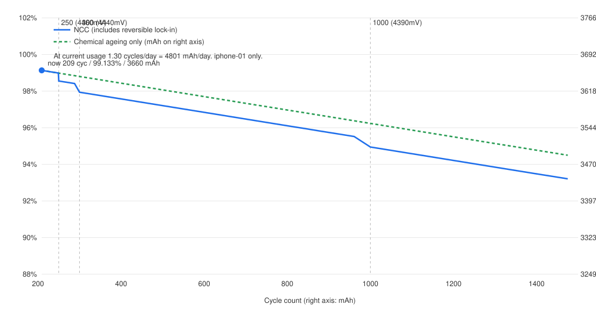

<div align="center">

# apple-device-metrics

[English](README.md) · **中文** · [网站](https://savues.github.io/apple-device-metrics/)

[](https://github.com/Savues/apple-device-metrics/actions/workflows/verify.yml)
[](https://savues.github.io/apple-device-metrics/)
[](LICENSE)


苹果设备电池与充电的长期测量数据，以去标识化开放数据发布。

</div>

> 本文为英文原文的中文翻译；数值、字段名与结论以[英文版](README.md)为准。

这里的所有数字都**来自 iOS analytics 快照和充电日志**，不来自宣传材料。目标是留下一份可复现的记录，说明系统报告的电池健康度随时间到底怎样变化。

### 速览（`iphone-01`，最新快照 2026-11-16）

| 循环 | NCC | NCC ÷ 3692 | 苹果显示值 | 充电电压上限 | 用量 |
|:-:|:-:|:-:|:-:|:-:|:-:|
| **209** | **3660 mAh** | **99.13%** | **101%** | **4480 mV** | **1.30 次循环/天** |

下一个节点：**250 次循环 → 4460 mV，约 2026-12-17**（已事前登记于
[`docs/predictions.json`](docs/predictions.json)）。

<p align="center"></p>

> **数据采集条件。** `iphone-01` 开启了 iOS *充电上限（Charge Limit）*，设为 **80% 作兜底**，但机主几乎每次都在 **80% 之前**拔线。因此苹果的偶尔满充校准虽已启用，却从未被观察到执行：76 天窗口内没有发生过一次满充。由循环次数驱动的结论（降压节点、预测）不受影响；电量计推算的容量和显示的 SOC 带有无法量化的偏差。见
> [`docs/shallow-charging-accuracy.md`](docs/shallow-charging-accuracy.zh.md)。

---

## 设备

| ID | 平台 | 数据 | 覆盖范围 |
|----|------|------|----------|
| [`iphone-01`](devices/iphone-01/) | **iPhone 17**，iOS 26.4.2，3.887V / 3692mAh / 4.50V 上限 | 8 份 analytics 快照 + 6 行健康导出，325 次充电会话，1 次电压读数 | 2026-09-01 → 2026-11-16（76 天充电日志） |
| [`reference-01`](devices/reference-01/README.zh.md) | iOS 17.6.1，1420 次循环，3.83V / 2815mAh / 4.45V | 单份 analytics 快照，**仅作参考** | 2026-11-15 |
| [`reference-02`](devices/reference-02/README.zh.md) | iOS 15.1，3.83V / 3110mAh / 4.45V | 铭牌 + 一份电量计快照（2919 次循环，67%）；**没有 `VacVoltageLimit`** | 2026-11-15 |

`reference-01` 和 `reference-02` 是额外的参考设备，只用于交叉核对降压节点阶梯、两种健康度指标的区别以及铭牌能量的一致性。它们放在独立目录里，**不参与**任何结论的统计。

更多设备可以作为 `devices/` 下的同级目录加入。

---

## 主要发现

> **先读这一条**：存在两个不同的"电池健康度"数字。
> `nominal_health_pct`（99.11%）是第三方导出工具按 `NominalChargeCapacity / 3692` 算出的比值。苹果自己的 analytics 字段 `MaximumCapacityPercent` 为 **101**，并且在 200 次循环的阶跃前后**没有变化**。下文所有衰减数字描述的都是 NCC 比值，不是 iOS 显示的值。见
> [`ANALYTICS-EVIDENCE.md`](devices/iphone-01/ANALYTICS-EVIDENCE.zh.md) §6。

1. **`nominal_health_pct = nominal_capacity_mah / 3692`**，分母是*固定的*铭牌额定容量。已在全部 6 个快照上核对，误差 ≤ 0.005 个百分点。`raw_capacity_mah` 列（3742→3692，会漂移）**不是**分母，也不进入健康度计算。

2. **衰减是阶梯式的，不是线性的。** 平台期每天约 ~0.004%（真实的化学老化），中间夹着两次一次性下降：126→152 次循环时约 ~-0.41pp，194→208 次循环时约 ~-0.43pp。

3. **194→208 这一段跨过了第 200 次循环**，与一个流传较广（非官方）的机制吻合：iOS 在循环节点（200 / 250 / 300 / 1000）下调软件充电电压上限，每档 −0.02V，≥1000 时 −0.05V。铭牌 4.50V 是硬件上限，软件上限设在它之下。见 [`docs/voltage-nodes.md`](docs/voltage-nodes.zh.md)。

4. **200 次循环的阶跃已被 analytics 证实**：**恰好在第 200 次循环**时 `VacVoltageLimit =
   4480 mV`，而铭牌为 4.50 V，正是预测的 −0.02 V 一档。另一台设备（铭牌 4.45 V，1420 次循环）独立证实了整条阶梯：
   `4.45 − 0.02×3 − 0.05 = 4.34 V` 等于它实测的 4340 mV。两种铭牌、两个 iOS 版本，同一张阶梯表。见
   [`docs/voltage-nodes.md`](docs/voltage-nodes.zh.md) 和
   [`devices/reference-01/`](devices/reference-01/README.zh.md)。

5. **老化曲线是凹的，不是线性的；显示的数字也不全是磨损。** 显示健康度的下降速度从早期每 100 次循环约 ~−2.31 pp 放缓到后期约 ~−0.40 pp。同一 4.50 V 平台上的 A/B 测量显示，把电压上限从 4500 降到 4390 mV，**报告容量减少 8.0 pp，而 Qmax 不变**。也就是说，苹果"1000 次循环保持 80%"中约 ~40% 的下降是可逆锁容，不是化学老化。降压是*保护性的*。完整推算：
   [`docs/lifetime-projection.md`](docs/lifetime-projection.zh.md)。

6. **充电行为**：325 次会话 / 76 天，98.83 次等效完整循环，平均 1.65%/min（排除异常后 1.76%/min）。18 次会话（5.5%）净充入为零，1 次在插电时 SOC 反而*下降*，异常记录共 19 条（5.8%）。

7. **`Raw Capacity` 是会漂移的估计值，连续快照可以证明**：11-14 → 11-15 `AppleRawMaxCapacity` 从 3683 变为 3692（+9 mAh），而 `NominalChargeCapacity` 和健康度都没变。它在 11-15 恰好等于 3692 铭牌值只是巧合。

8. **−0.43 pp 的断崖是日常噪声的 16 倍。** 连续 8 份 analytics 快照的 NCC 在 3658–3660 mAh 之间（抖动 0.027 pp，含回升），而 `AppleRawMaxCapacity` 波动 30 mAh（噪声大 30 倍）。断崖被限定在 194→200 次循环之间（1.50 次循环/天）。11-09 的文件显示**恰好在第 200 次循环时为 4480 mV**，说明阶跃在节点上触发，而不是之后；其电量计 `UpdateTime`（本地时间 2026-11-08 17:08）把阶跃限定在这个时间之前。11-12 是 11-11 的重复上报。

完整分析（包括对早期误读的纠正）见 [`docs/findings.md`](docs/findings.zh.md)。

---

## 数据与隐私

原始充电日志带有精确到秒的墙钟时间戳，**这些时间戳不发布**。发布的会话记录只包含：

`session_id`、`day_offset`（距首条记录的天数，不含日历日期）、
`duration_sec`、`soc_start`、`soc_end`、`charged_pct`、
`rate_pct_per_min`、`anomaly`。

发布原始时间戳会暴露作息和出行规律，所以解析时就把它们去掉了。健康度快照保留日期（6 个点，不含行为细节）。序列号、UDID、具体机型变体标识和 analytics 源文件名都不发布。机型系列（`iPhone 17`）经机主同意后发布，具体变体不发布。

---

## 复现

```sh
# Import new analytics files, regenerate the forecast and run every check
scripts/update.sh /path/Analytics-A.ips /path/Analytics-B.ips

# Or only re-run the checks (also confirms the committed forecast equals a
# fresh regeneration, and scores pre-registered predictions)
python3 scripts/verify.py
python3 scripts/check_links.py

# Re-parse a private raw diary into the de-identified CSV
# (raw diary is deliberately NOT in this repository)
python3 scripts/parse_charging_log.py /path/to/private/raw.txt \
    devices/iphone-01/charging-sessions.csv docs/charging-summary.json
```

| 路径 | 内容 |
|------|------|
| [`devices/iphone-01/health-samples.csv`](devices/iphone-01/health-samples.csv) | 6 行第三方健康导出（不是 analytics 快照） |
| [`devices/iphone-01/charging-sessions.csv`](devices/iphone-01/charging-sessions.csv) | 325 次去标识化充电会话 |
| [`devices/iphone-01/device.json`](devices/iphone-01/device.json) | 铭牌参数 |
| [`devices/iphone-01/voltage-reading.md`](devices/iphone-01/voltage-reading.zh.md) | 一次 4.04V @ 70% 读数 + OCV 核对 |
| [`docs/findings.md`](docs/findings.zh.md) | 完整分析 |
| [`docs/lifetime-projection.md`](docs/lifetime-projection.zh.md) | 一般性寿命推理（跨设备背景；**不是** iphone-01 的预测） |
| [`docs/iphone17-forecast.md`](docs/iphone17-forecast.zh.md) | **仅用 iphone-01 数据的未来电池曲线**，按当前用量（1.30 次循环/天 = 4801 mAh/天），给出真实 mAh |
| `docs/iphone17-forecast.csv` / `.json` / `.svg` | 预测数据与图表 |
| [`docs/voltage-capacity-experiment.json`](docs/voltage-capacity-experiment.json) | A/B 测量：电压上限与报告容量 |
| [`scripts/forecast.py`](scripts/forecast.py) | 重新生成 iphone-01 预测 |
| [`scripts/params.py`](scripts/params.py) | 从发布数据推导所有预测参数（起点、用量、平台期、节点阶跃），没有手填常量 |
| [`scripts/update.sh`](scripts/update.sh) | 一条命令完成导入 → 时间线 → 预测 → 校验 |
| [`scripts/check_links.py`](scripts/check_links.py) | 检查相对 Markdown 链接是否断开 |
| [`docs/predictions.json`](docs/predictions.json) | **事前登记**的 250 节点预测，由 `verify.py` 自动评分 |
| [`docs/voltage-nodes.md`](docs/voltage-nodes.zh.md) | 循环节点电压表及其来源 |
| [`docs/methodology.md`](docs/methodology.zh.md) | 字段定义、单位、已知局限 |
| [`docs/shallow-charging-accuracy.md`](docs/shallow-charging-accuracy.zh.md) | **开了 80% 充电上限但在 80% 前拔线**：为什么校准满充从未执行，以及它影响哪些读数 |
| [`docs/corrections.md`](docs/corrections.zh.md) | 分析过程中发现并纠正的错误 |
| [`devices/iphone-01/ANALYTICS-EVIDENCE.md`](devices/iphone-01/ANALYTICS-EVIDENCE.zh.md) | 原始 analytics 字段 + 已证实的降压阶跃 |
| `devices/iphone-01/analytics/YYYY-MM-DD.json` | 白名单提取结果，每个日期一份 |
| [`devices/iphone-01/analytics-timeline.csv`](devices/iphone-01/analytics-timeline.csv) | 合并后的日期 / 循环 / 电压 / 健康度时间线 |
| [`docs/charging-summary.json`](docs/charging-summary.json) | 计算得到的汇总值 |
| [`scripts/verify.py`](scripts/verify.py) | 一致性校验 |
| [`scripts/parse_charging_log.py`](scripts/parse_charging_log.py) | 充电日志解析 / 去标识化 |
| [`scripts/extract_analytics.py`](scripts/extract_analytics.py) | analytics `.ips` 解析 / 去标识化 |
| [`scripts/ingest_analytics.py`](scripts/ingest_analytics.py) | 追加纯文本健康表导出 |

---

## 结论的来源状态

循环节点电压表是**第三方逆向结果**，不是苹果文档。苹果公开资料只说"1000 次循环后保持 80% 容量"，并介绍了性能管理和优化充电。本仓库中的内容都按此标注。

**更新（2026-11-16）**：200 次循环的阶跃已在本机直接证实：**恰好在 `CycleCount = 200`** 时 `VacVoltageLimit = 4480 mV`（2026-11-09 analytics），此后另外 7 份 202–209 次循环的快照也都是 4480 mV。见
[`devices/iphone-01/ANALYTICS-EVIDENCE.md`](devices/iphone-01/ANALYTICS-EVIDENCE.zh.md)。
不再需要中段 SOC 电压测试。iOS 只保留约 ~7–8 天的 analytics，所以 200 次循环之前的快照（4500 mV）**已无法获得**；生命周期峰值 `MaximumPackVoltage = 4496 mV` 在当前 4480 mV 上限下不可能出现，是 09-01 之前（≈101 次循环）4.50 V 上限生效时一次满充留下的"化石"。充电日志从未超过 81% SOC（69/79% 集中：在 80% 充电上限之前拔线），所以这个峰值之后不可能被刷新。见
[`devices/iphone-01/ANALYTICS-EVIDENCE.md`](devices/iphone-01/ANALYTICS-EVIDENCE.zh.md)。

## 导入新的 analytics 文件

提供任意 `.ips` / `.ips.ca.synced` 每日 analytics 文件，**每个日期一份**。格式为 NDJSON：一行文件头加若干命名的聚合记录。可以一次导入多份：

```sh
python3 scripts/extract_analytics.py --archive /path/Analytics-A.ips /path/Analytics-B.ips
```

完整刷新请用参数相同的 `scripts/update.sh`：它还会以新的最新快照重新生成预测并运行 `verify.py`。`docs/*.md` 正文中引用起点的文字仍需人工复核。

每个文件写入 `devices/iphone-01/analytics/<header-date>.json`，重建 `analytics-timeline.csv`，并把每份快照与循环节点电压表（4500 / 4480 / 4460 / 4440 / 4390 mV）比对。不匹配时打印 `??`，不会静默通过。重复导入同一日期会原地更新。`python3 scripts/verify.py` 会重新校验整个归档；每次 push 时 GitHub Actions 会运行它、链接检查以及原始文件 / 标识字段扫描。

只输出白名单内的数值型电池字段；原始文件（含 deviceId、UUID、运营商 / 国家和 incident ID）绝不能提交。200 次循环之前的快照尤其有价值。纯文本健康表导出请用 `scripts/ingest_analytics.py`。

## 许可

数据与脚本：CC0-1.0（公有领域）。见 [`LICENSE`](LICENSE)。
