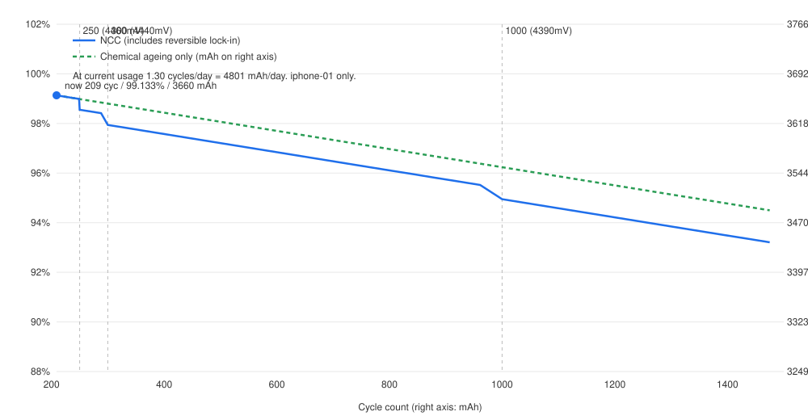

# iphone-01 (iPhone 17) — battery curve forecast

**Scope**: compute the main device's future curve from its own
data only. The two reference devices are **excluded** from this forecast
(irregular usage; their ageing anchors must not be fitted to this device).
Apple's "80% at 1000 cycles" is likewise not used as an anchor.

Every parameter below is derived by [`scripts/params.py`](../scripts/params.py)
from the published data: the base is the latest analytics snapshot, nodes
already passed are not charged again. Pre-registered checks for the next node
are in [`predictions.json`](predictions.json).

Reproduce: `python3 scripts/forecast.py` →
[`iphone17-forecast.csv`](iphone17-forecast.csv),
[`iphone17-forecast.json`](iphone17-forecast.json),
[`iphone17-forecast.svg`](iphone17-forecast.svg).

---

## 1. Every parameter comes from this device

| Parameter | Value | Source on `iphone-01` |
|-----------|-------|------------------------|
| Base date / cycle | <!--v:base_date-->2026-11-27<!--/--> / <!--v:base_cycle-->223<!--/--> | <!--v:base_md-->11-27<!--/--> analytics (latest snapshot) |
| Base NCC / health | <!--v:base_ncc-->3661<!--/--> mAh / **<!--v:base_health-->99.160<!--/-->%** | <!--v:base_md-->11-27<!--/--> analytics, `NCC/3692` |
| Apple `MaximumCapacityPercent` | **101** | all <!--v:snap_n-->19<!--/--> analytics files |
| Cycle rate (current) | **<!--v:rate-->1.29<!--/--> /day = <!--v:mah_day-->4769<!--/--> mAh/day** | <!--v:span_days-->85<!--/-->-day charging diary (<!--v:charged_sum-->10980<!--/-->% = <!--v:charged_mah-->405,382<!--/--> mAh). Cross-check: <!--v:gauge_n-->16<!--/--> non-stale analytics gauge writes (CycleCount <!--v:gauge_cycles-->200→223<!--/--> over <!--v:gauge_span-->17.79<!--/--> days) = <!--v:gauge_rate-->1.314<!--/-->/day by regression; both rely on coulomb counting, so this is not independent |
| Plateau slope | **0.00476 pp/day = 0.176 mAh/day** | mean of 3 non-step segments in that export |
| Step per 20 mV node | **−0.43 pp = −15.9 mAh** | the 200-node step (3675→3659 mAh) |
| Voltage nodes | 250 / 300 / ≥1000 → 4460 / 4440 / 4390 mV | third-party table (≥1000 extrapolated) |

**Base caveat**: the 11-16 NCC (3660 mAh) is **+1 mAh above** 11-15 (3659).
That is the device's normal daily gauge jitter (±1–2 mAh including
rebounds), not a real recovery. Starting from this single latest point shifts
every forecast figure up by ~1 mAh / 0.027 pp; see §4 confidence.

**Rate correction**: an earlier version used **1.5386 cycles/day** from a
57-day regression on sparse export rows. That is *not* current usage — it
was pulled up by a heavy 30-day stretch. Measured current usage is
~<!--v:rate_low-->1.09<!--/-->–<!--v:rate-->1.29<!--/--> cycles/day across the windows in §3.1, cross-checked two
ways on this device. The old rate
is kept only as a sensitivity case in §3.1.

Not used: `reference-01` (1420/73%), `reference-02` (2919/67%), the
cross-device concave curve in
[`lifetime-projection.md`](lifetime-projection.md) §1A, and the official
1000/80 specification. That earlier concave curve described *other* devices
and is **not** a prediction for this one.

## 2. Model

<!--b:fc_model-->

```
health(cycle) = 99.160
              − 0.00476 × days                 (plateau / chemical ageing)
              − 0.43  × (# of future nodes)   (reversible lock-in)
chemical_only(cycle) = 99.160 − 0.00476 × days
days = (cycle − 223) / 1.29                 (CURRENT usage)
mAh  = pct / 100 × 3692                     (fixed nameplate)
```

<!--/b-->

Two curves are drawn:

- **Blue** — `NCC/nameplate`, the figure this repo tracks. Includes the
  node lock-in steps.
- **Green dashed** — chemical ageing only, i.e. the blue curve with the
  reversible lock-in removed. This is the closest thing to "real wear".

The SVG's **right axis is mAh**, so both curves can be read as real capacity.

`MaximumCapacityPercent` (Apple's displayed health) is **not modelled**:
this device has shown a constant 101 across all <!--v:snap_word-->nineteen<!--/--> analytics files,
including across the 200-cycle step. There is no observed change from which
to fit a curve. Do not assume it follows the blue line.

## 3. Result — future curve, in real mAh

<!--b:fc_nodes_en-->

| Date | Cycles | Voltage | NCC health | **NCC mAh** | Lock-in mAh | Chemical-only mAh |
|------|--------|---------|-----------|-------------|-------------|-------------------|
| 2026-11-27 (now) | 223 | 4480 mV | **99.160%** | **3661** | 0 | 3661 |
| **2026-12-17** | 250 | 4460 mV | **98.631%** | **3641** | 16 | 3657 |
| **2027-01-25** | 300 | 4440 mV | **98.016%** | **3619** | 32 | 3651 |
| **2028-07-21** | 1000 | 4390 mV | **95.003%** | **3508** | 48 | **3555** |

<!--/b-->



At 1000 cycles: **NCC ≈ <!--v:ncc_kilo-->3508<!--/--> mAh**, of which **<!--v:lockin_kilo-->48<!--/--> mAh is reversible
lock-in**; genuine chemical wear is only **<!--v:wear_kilo-->137<!--/--> mAh** (3692 nameplate → <!--v:chem_kilo-->3555<!--/-->, −<!--v:wear_kilo_pct-->3.7<!--/-->%).

**Read it this way**: the blue line falls mainly in **small discrete steps**
at 250 and 300 cycles, then resumes a very shallow plateau. Between nodes
the cell loses just **0.176 mAh/day ≈ 5.3 mAh/month**. Each voltage node
costs ~**16 mAh** of displayed capacity, reversibly.

### 3.1 Sensitivity to daily usage rate

All rates below were measured on this device in different windows; the
health at a given cycle barely changes, but the **dates** move a lot.

<!--b:fc_sens_en-->

| Usage window | cycles/day | mAh/day | 250 node | 1000 node | NCC mAh @1000 |
|--------------|-----------|---------|----------|-----------|---------------|
| recent 7 days | 1.09 | 4024 | 2026-12-21 | 2028-11-08 | 3488 |
| recent 14 days | 1.11 | 4098 | 2026-12-21 | 2028-10-27 | 3490 |
| independent gauge snapshots (regression) | 1.314 | 4851 | 2026-12-17 | 2028-07-10 | 3510 |
| **full 85-day diary (primary)** | **1.29** | **4769** | **2026-12-17** | **2028-07-21** | **3508** |
| recent 30 days | 1.34 | 4947 | 2026-12-17 | 2028-06-28 | 3512 |
| old 57-day regression (withdrawn) | 1.5386 | 5681 | 2026-12-14 | 2028-04-15 | 3525 |

<!--/b-->

So the earlier "1000 cycles ≈ 2028-04" was an artefact of the inflated rate;
at current usage it is **~2028-07**, three months later.

## 4. What this says about lifetime

- The step-down is **protective**. Lowering the upper cut-off voltage slows
  degradation (BU-808 direction, high confidence); the small capacity cost
  is reversible.
- On this device's own numbers there is **no sign of accelerating wear**.
  The plateau slope is measured from its own data and is tiny.
- That is why the earlier cross-device concave curve should not be applied:
  it was shaped by `reference-01/02`, which are older phones with irregular
  usage.
- **80% is not a deadline here.** With ~0.0048 pp/day plateau plus three
  remaining node steps, this curve does not reach 80% within the modelled
  window (to 1500 cycles). The official 1000/80 figure is a displayed-value
  commitment that contains lock-in, not a wear measurement (see
  [`corrections.md`](corrections.md) §8).

## 5. Confidence and caveats

| Aspect | Confidence |
|--------|------------|
| Current usage rate (<!--v:mah_day-->4769<!--/--> mAh/day) | **Medium** — diary and gauge regression (<!--v:gauge_rate-->1.314<!--/-->/day) agree within <!--v:gauge_agree-->2<!--/-->%, but share the coulomb-count source; an uncalibrated SOC gain error would shift calendar dates, not the curve shape. See [`shallow-charging-accuracy.md`](shallow-charging-accuracy.md) §5 |
| Plateau slope | **High** — measured on this device |
| Base NCC (<!--v:base_ncc-->3661<!--/--> mAh, <!--v:base_md-->11-27<!--/--> single point) | Medium — daily jitter ±1–2 mAh; a 3-day mean would be steadier |
| 250 / 300 node dates | Medium — assumes <!--v:rate-->1.29<!--/-->/day continues; see §3.1 sensitivity |
| −0.43 pp (−15.9 mAh) per node | Medium — one node observed; assumes later nodes same size |
| ≥1000 band (4390 mV) | **Low** — extrapolated from the iPhone 13 series |
| Long-term plateau staying linear | **Low** — real cells can accelerate with heat/high SOC; not modelled |
| Apple displayed health | **Not modelled** — no observed variation |

The model has **no ageing acceleration term**. That makes
it optimistic beyond ~500 cycles. Treat everything past 1000 cycles as an
extrapolation, not a prediction.

Revisit at the 250-cycle node (~<!--v:date_next-->2026-12-17<!--/--> at current usage): one new
analytics file will confirm `VacVoltageLimit = 4460 mV`, show whether the
step is again −0.43 pp / −15.9 mAh, and whether Apple's displayed 101
finally moves. These are registered in advance in
[`predictions.json`](predictions.json) (voltage exact; step 16 ± 6 mAh;
date 2026-12-12 … 12-28) and `verify.py` prints HIT / MISS once a
≥250-cycle snapshot is imported.
