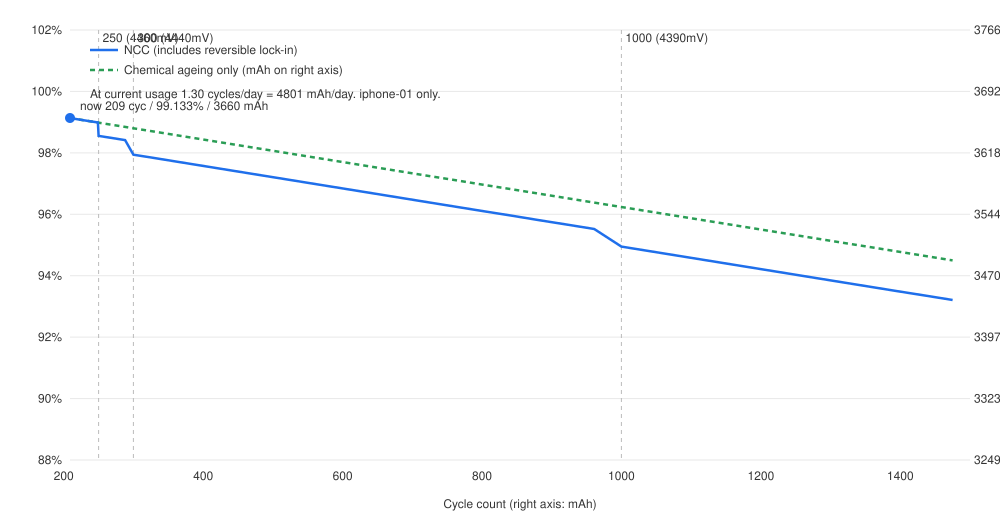

# iphone-01（iPhone 17）—— 电池曲线预测

[English](iphone17-forecast.md) · **中文**

> 本文为英文原文的中文翻译；数值、字段名与结论以[英文版](iphone17-forecast.md)为准。

**机主要求**：只用主设备自身的数据计算其未来曲线。两台参考设备**不纳入**本预测（使用不规律；其老化锚点不得拟合到本设备上）。Apple 的“1000 次循环时 80%”同样不作为锚点。

下文每个参数都由 [`scripts/params.py`](../scripts/params.py)
从已公开数据推导：基点取最新的 analytics 快照，已经越过的节点不再重复计入。下一个节点的事前登记检查见 [`predictions.json`](predictions.json)。

复现：`python3 scripts/forecast.py` →
[`iphone17-forecast.csv`](iphone17-forecast.csv)、
[`iphone17-forecast.json`](iphone17-forecast.json)、
[`iphone17-forecast.svg`](iphone17-forecast.svg)。

---

## 1. 每个参数都来自本设备

| 参数 | 数值 | 在 `iphone-01` 上的来源 |
|-----------|-------|------------------------|
| 基点日期 / 循环 | <!--v:base_date-->2026-11-17<!--/--> / <!--v:base_cycle-->212<!--/--> | <!--v:base_md-->11-17<!--/--> analytics（最新快照） |
| 基点 NCC / 健康度 | <!--v:base_ncc-->3660<!--/--> mAh / **<!--v:base_health-->99.133<!--/-->%** | <!--v:base_md-->11-17<!--/--> analytics，`NCC/3692` |
| Apple `MaximumCapacityPercent` | **101** | 全部 <!--v:snap_n-->9<!--/--> 个 analytics 文件 |
| 循环速率（当前） | **<!--v:rate-->1.30<!--/--> /day = <!--v:mah_day-->4801<!--/--> mAh/day** | <!--v:span_days-->76<!--/--> 天充电日志（9883% = 364,880 mAh）。交叉核对：<!--v:gauge_n-->8<!--/--> 次非旧快照的 analytics 电量计写入（<!--v:gauge_span-->8.37<!--/--> 天内 CycleCount <!--v:gauge_cycles-->200→212<!--/-->）回归得到 <!--v:gauge_rate-->1.324<!--/-->/day；两者都依赖库仑计数，因此并不独立 |
| 平台期斜率 | **0.00476 pp/day = 0.176 mAh/day** | 该导出中 3 个非阶跃区段的均值 |
| 每个 20 mV 节点的阶跃 | **−0.43 pp = −15.9 mAh** | 200 节点处的阶跃（3675→3659 mAh） |
| 电压节点 | 250 / 300 / ≥1000 → 4460 / 4440 / 4390 mV | 第三方表格（≥1000 为外推） |

**基点注意事项**：11-16 的 NCC（3660 mAh）相对 11-15（3659）为 **+1 mAh**。
这是本设备正常的每日电量计抖动（±1–2 mAh，含回弹），并非真实恢复。以这一个最新点为起点，会使所有预测数值上移约 1 mAh / 0.027 pp；见 §4 置信度。

**速率更正**：早期版本使用的是对稀疏导出行做 57 天回归得到的 **1.5386 cycles/day**。那*不是*当前的使用强度 —— 它被一段 30 天的高强度使用拉高了。实测当前使用强度约为 1.23–1.30 cycles/day，并在本设备上用两种方式交叉核对。旧速率仅作为 §3.1 中的敏感性情形保留。

未使用：`reference-01`（1420/73%）、`reference-02`（2919/67%）、
[`lifetime-projection.md`](lifetime-projection.zh.md) §1A 中的跨设备凹曲线，以及官方
1000/80 规格。那条早期的凹曲线描述的是*其他*设备，**不是**对本设备的预测。

## 2. 模型

<!--b:fc_model-->

```
health(cycle) = 99.133
              − 0.00476 × days                 (plateau / chemical ageing)
              − 0.43  × (# of future nodes)   (reversible lock-in)
chemical_only(cycle) = 99.133 − 0.00476 × days
days = (cycle − 212) / 1.30                 (CURRENT usage)
mAh  = pct / 100 × 3692                     (fixed nameplate)
```

<!--/b-->

图中画了两条曲线：

- **蓝色** —— `NCC/nameplate`，即本仓库跟踪的数值。包含节点锁容阶跃。
- **绿色虚线** —— 仅化学老化，即去掉可逆锁容后的蓝色曲线。这是最接近“真实磨损”的量。

SVG 的**右轴单位是 mAh**，因此两条曲线都可以按真实容量读取。

`MaximumCapacityPercent`（Apple 显示的健康度）**未建模**：
本设备在全部<!--v:snap_zh-->九<!--/-->个 analytics 文件中始终显示 101，包括跨越 200 循环阶跃时。没有观测到任何变化可用于拟合曲线。不要假设它会沿蓝线变化。

## 3. 结果 —— 以真实 mAh 表示的未来曲线

<!--b:fc_nodes_zh-->

| 日期 | 循环次数 | 电压 | NCC 健康度 | **NCC mAh** | 锁容 mAh | 仅化学老化 mAh |
|------|--------|---------|-----------|-------------|-------------|-------------------|
| 2026-11-17（当前） | 212 | 4480 mV | **99.133%** | **3660** | 0 | 3660 |
| **2026-12-16** | 250 | 4460 mV | **98.564%** | **3639** | 16 | 3655 |
| **2027-01-23** | 300 | 4440 mV | **97.951%** | **3616** | 32 | 3648 |
| **2028-07-15** | 1000 | 4390 mV | **94.958%** | **3506** | 48 | **3554** |

<!--/b-->



1000 次循环时：**NCC ≈ <!--v:ncc_kilo-->3506<!--/--> mAh**，其中 **<!--v:lockin_kilo-->48<!--/--> mAh 是可逆锁容**；真正的化学磨损只有 **<!--v:wear_kilo-->139<!--/--> mAh**（额定 3692 → <!--v:chem_kilo-->3554<!--/-->，−<!--v:wear_kilo_pct-->3.8<!--/-->%）。

**应这样解读**：蓝线主要在 250 和 300 次循环处以**小幅离散阶跃**下降，之后回到非常平缓的平台期。节点之间电芯每天只损失 **0.176 mAh/day ≈ 5.3 mAh/month**。每个电压节点会可逆地使显示容量减少约 **16 mAh**。

### 3.1 对每日使用速率的敏感性

下列速率均为本设备在不同窗口内的实测值；给定循环次数下的健康度几乎不变，但**日期**变化很大。

<!--b:fc_sens_zh-->

| 使用窗口 | cycles/day | mAh/day | 250 节点 | 1000 节点 | 1000 时 NCC mAh |
|--------------|-----------|---------|----------|-----------|---------------|
| 最近 7 天 | 0.99 | 3655 | 2026-12-25 | 2029-01-20 | 3473 |
| 最近 14 天 | 1.21 | 4467 | 2026-12-18 | 2028-08-29 | 3498 |
| 独立电量计快照（回归） | 1.324 | 4888 | 2026-12-15 | 2028-07-04 | 3508 |
| **完整 76 天充电日志（主值）** | **1.30** | **4801** | **2026-12-16** | **2028-07-15** | **3506** |
| 最近 30 天 | 1.53 | 5649 | 2026-12-11 | 2028-04-15 | 3522 |
| 旧的 57 天回归（已撤回） | 1.5386 | 5681 | 2026-12-11 | 2028-04-12 | 3522 |

<!--/b-->

因此，早先的“1000 次循环 ≈ 2028-04”是速率偏高造成的假象；按当前使用强度应为 **~2028-07**，晚三个月。

## 4. 这对寿命意味着什么

- 降压具有**保护作用**。降低充电截止电压可以减缓衰减（BU-808 所指方向，高置信度）；少量的容量代价是可逆的。
- 按本设备自身的数据，**没有磨损加速的迹象**。平台期斜率由其自身数据测得，非常小。
- 这就是不应套用早先跨设备凹曲线的原因：
  那条曲线由 `reference-01/02` 决定，而机主称这两台设备的使用不规律。
- **80% 在这里并不是期限。** 以约 0.0048 pp/day 的平台期斜率加上剩余三次节点阶跃计算，这条曲线在建模窗口内（到 1500 次循环）不会降到 80%。官方的 1000/80 数值是包含锁容在内的显示值承诺，而不是磨损测量值（见
  [`corrections.md`](corrections.zh.md) §8）。

## 5. 置信度与注意事项

| 方面 | 置信度 |
|--------|------------|
| 当前使用速率（<!--v:mah_day-->4801<!--/--> mAh/day） | **中** —— 充电日志与电量计回归（<!--v:gauge_rate-->1.324<!--/-->/day）相差在 <!--v:gauge_agree-->2<!--/-->% 以内，但共用库仑计数这一来源；未经校准的 SOC 增益误差会移动日历日期，而不会改变曲线形状。见 [`shallow-charging-accuracy.md`](shallow-charging-accuracy.zh.md) §5 |
| 平台期斜率 | **高** —— 在本设备上实测 |
| 基点 NCC（<!--v:base_ncc-->3660<!--/--> mAh，<!--v:base_md-->11-17<!--/--> 单点） | 中 —— 每日抖动 ±1–2 mAh；取 3 天均值会更稳 |
| 250 / 300 节点日期 | 中 —— 假设 1.30/day 持续不变；见 §3.1 敏感性 |
| 每个节点 −0.43 pp（−15.9 mAh） | 中 —— 只观测到一个节点；假设后续节点幅度相同 |
| ≥1000 区间（4390 mV） | **低** —— 由 iPhone 13 系列外推 |
| 长期平台期保持线性 | **低** —— 真实电芯在高温/高 SOC 下可能加速衰减；未建模 |
| Apple 显示的健康度 | **未建模** —— 未观测到变化 |

模型有意**不包含老化加速项**。这使它在约 500 次循环之后偏乐观。1000 次循环之后的一切都应视为外推，而不是预测。

在 250 循环节点（按当前使用强度约 <!--v:date_next-->2026-12-16<!--/-->）复查：一个新的
analytics 文件将证实 `VacVoltageLimit = 4460 mV`，显示阶跃是否同样为 −0.43 pp / −15.9 mAh，以及 Apple 显示的 101 是否终于变化。这些已事先登记在
[`predictions.json`](predictions.json) 中（电压精确值；阶跃 16 ± 6 mAh；
日期 2026-12-12 … 12-28），导入 ≥250 次循环的快照后，`verify.py` 会打印 HIT / MISS。
